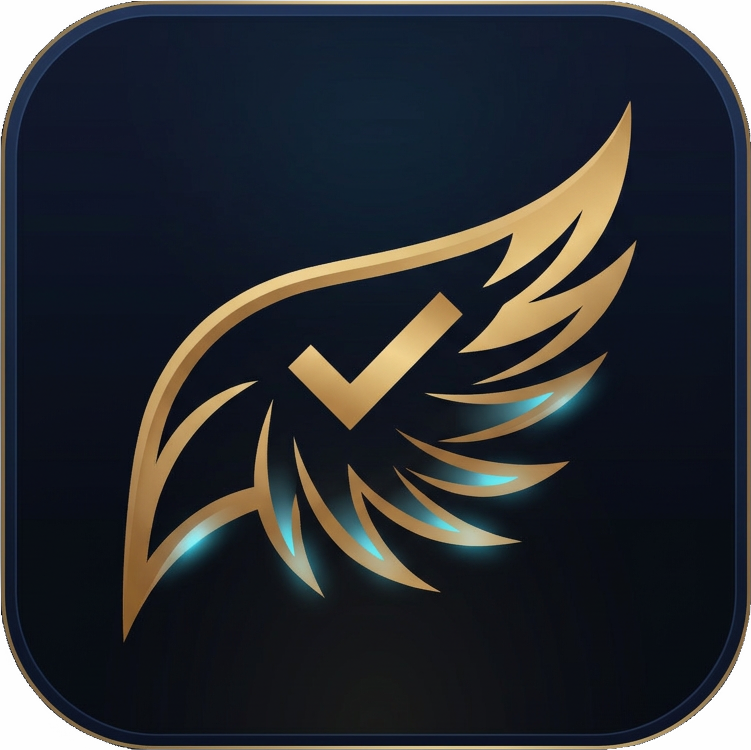
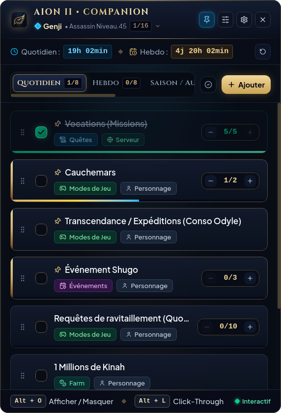
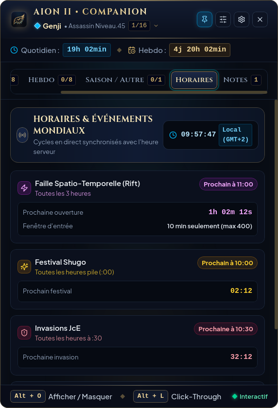
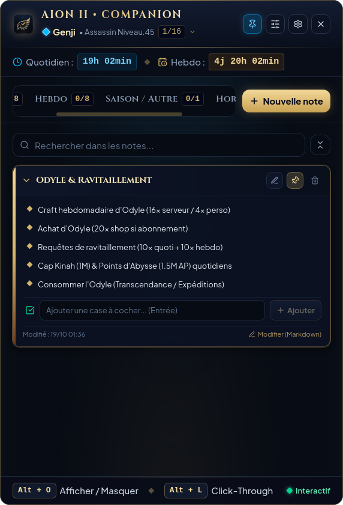
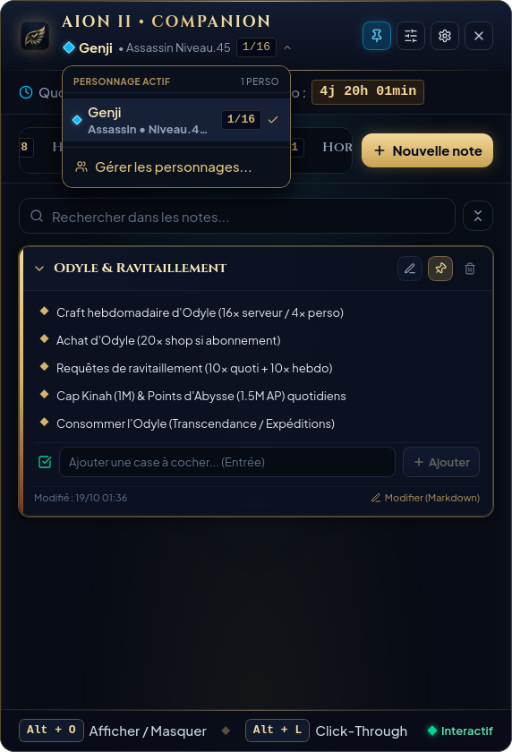
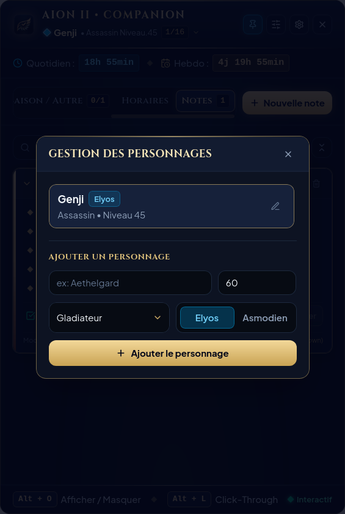
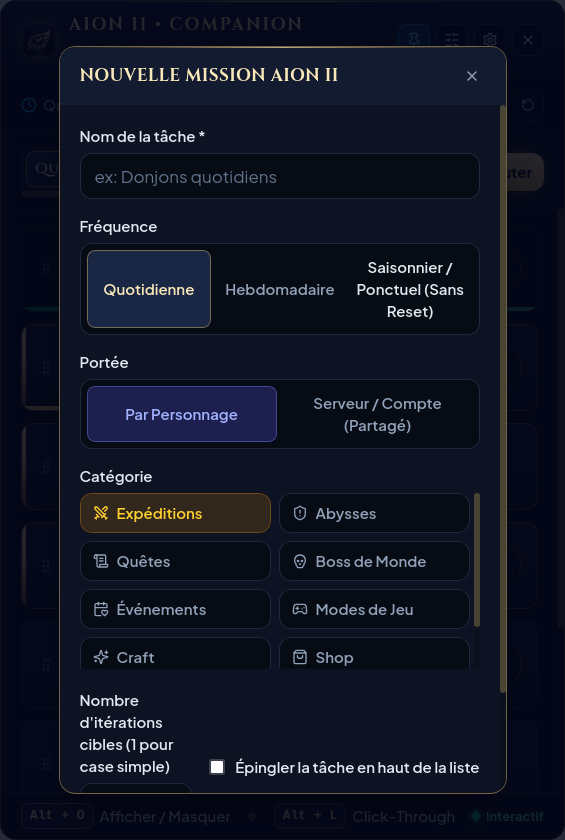
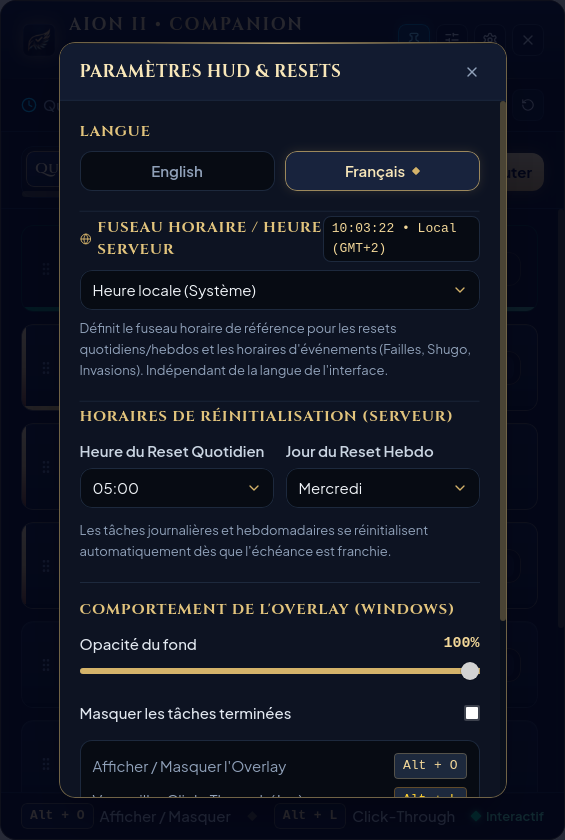
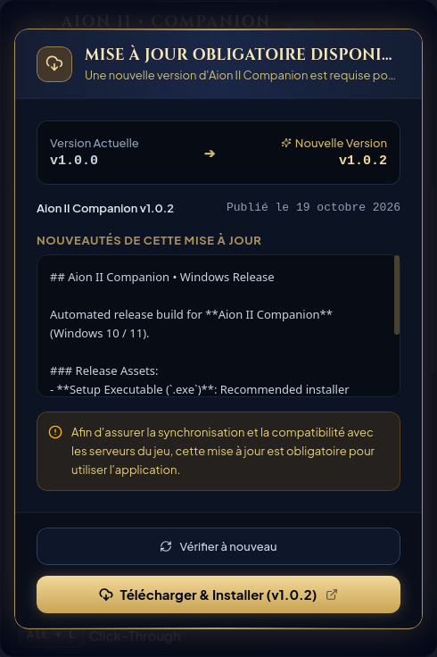

  

# Aion II • Companion

  <strong>Le HUD tactique en jeu & Codex de routines quotidiennes ultime pour Aion 2</strong>

  <a href="README.md">🇬🇧 English</a> &nbsp;|&nbsp; <strong>🇫🇷 Français</strong>

  
  
  
  
  

---

## 🛡️ 100% Local, Privé & Garanti Sans Risque Anti-Cheat

> [!IMPORTANT]
> **Aucun compte requis • Données 100% locales • Zéro injection DLL • Zéro risque de bannissement**

- **Aucun compte ni mot de passe requis** : L'application ne vous demandera **jamais** d'identifiant, d'adresse email ou de mot de passe Aion 2. Tout est prêt à l'emploi dès le premier lancement, sans inscription.
- **Stockage 100% Local & Privé** : Vos personnages, vos routines, vos notes et vos réglages sont stockés exclusivement sur votre propre ordinateur (stockage local). Aucune donnée personnelle n'est transmise à un serveur externe ou dans le cloud.
- **Zéro Injection DLL / Zéro Hook mémoire** : L'application n'injecte strictement aucun code ni aucune DLL dans le client de jeu d'Aion 2, ne lit pas la mémoire vive (RAM) du jeu et ne modifie aucun fichier du jeu.
- **Zéro interception de paquets** : Le compagnon n'effectue aucune écoute réseau (*packet sniffing*).
- **Overlay Externe Inoffensif (type Discord ou OBS)** : L'application fonctionne exactement comme un widget de bureau ou une page web transparente qui flotte sur vos écrans. Pour les moteurs anti-cheat (Easy Anti-Cheat, GameGuard, Xigncode, NCsoft Security), c'est une application externe classique, totalement inoffensive au même titre qu'un bloc-notes, Spotify ou Discord.
- **Conformité totale & Sécurité maximale** : Aucun risque de suspension ni de bannissement de votre compte.

---

## Vue d'ensemble

**Aion II • Companion** est un overlay HUD transparent, fluide et ultra-léger conçu sur mesure pour les joueurs d'**Aion 2**. Conçu pour flotter discrètement par-dessus votre jeu sans jamais avoir besoin d'Alt-Tab, il centralise vos routines quotidiennes, plafonds hebdomadaires, horaires des événements mondiaux, failles spatio-temporelles et mémos tactiques.

Propulsé par un cœur natif en Rust (Tauri v2) et une interface soignée en React 19 et Tailwind CSS v4, le compagnon offre une réactivité instantanée, une empreinte matérielle quasi nulle (< 40 Mo de RAM, 0% CPU au repos) et une esthétique aux tons sombres et dorés fidèle à l'univers d'Atréia.

---

## 📸 Aperçu de l'Application

<table>
  <tr>
    <td align="center" width="50%">
      <strong>Routines Quotidiennes & Hebdomadaires</strong>  
      
    </td>
    <td align="center" width="50%">
      <strong>Horaires & Événements Mondiaux en Direct</strong>  
      
    </td>
  </tr>
  <tr>
    <td align="center" width="50%">
      <strong>Bloc-Notes Tactique & Checklists Interactives</strong>  
      
    </td>
    <td align="center" width="50%">
      <strong>Sélecteur Rapide de Personnages</strong>  
      
    </td>
  </tr>
  <tr>
    <td align="center" width="50%">
      <strong>Gestion des Personnages (Classes & Factions)</strong>  
      
    </td>
    <td align="center" width="50%">
      <strong>Création de Missions Personnalisées</strong>  
      
    </td>
  </tr>
  <tr>
    <td align="center" width="50%">
      <strong>Paramètres HUD, Fuseau Horaire & Resets</strong>  
      
    </td>
    <td align="center" width="50%">
      <strong>Mise à Jour Automatique Intégrée</strong>  
      
    </td>
  </tr>
</table>

---

## Fonctionnalités Clés

### 1. Overlay HUD Transparent & Mode Ultra-Minimal
- **Deux Modes d'Affichage (Classique & Ultra-Minimal)** :
  - **HUD Classique (`460×680`)** : Design riche aux couleurs d'Atréia (acier sombre et or) avec badges de catégories et barres de progression détaillées.
  - **Mode Ultra-Minimal (`350×440`)** : Interface ultra-compacte pensée pour ne jamais gêner en plein combat : tâches condensées sur une ligne, sélecteur d'onglets en menu déroulant vertical, popups minimalistes et ombres portées haute lisibilité. Basculez d'un mode à l'autre en un clic depuis l'en-tête ou les paramètres.
- **Opacité Indépendante par Mode** : Chaque mode mémorise son propre réglage de transparence — de **40% à 100%** en mode Classique, et de **0% (fond 100% transparent) à 100%** en mode Ultra-Minimal.
- **Toujours au premier plan (Always on Top)** : Flotte directement sur le jeu en mode fenêtré sans bordure (*Borderless*) ou fenêtré (activable/désactivable à tout moment via l'icône d'épingle dans les deux modes).
- **Mode Traversée de Clics (`Alt + L`)** : Rend l'overlay transparent aux clics de souris, vous permettant de continuer à jouer, cibler et combattre dans Aion 2 tout en gardant vos compteurs et vos objectifs affichés.
- **Mode Réduit / Mini HUD (`Alt + O`)** : Réduisez l'overlay en une pastille compacte et discrète en un clic ou avec un raccourci clavier, et restaurez la fenêtre complète quand vous le souhaitez.
- **Déplacement libre** : Déplacez facilement le HUD par simple glisser-déposer sur n'importe quel écran.

---

### 2. Gestion Multi-Personnages & Périmètres
- **Changement instantané de héros** : Basculez entre vos différents personnages via le menu déroulant de l'en-tête.
- **Support complet des 8 classes et des 2 factions** :
  - Classes : *Gladiateur, Templier, Assassin, Rôdeur, Sorcier, Spiritualiste, Clerc, Aède*.
  - Factions : *Élyséens* et *Asmodiens*.
- **Moteur à double portée (Scope)** :
  - **Portée Personnage** : Suivez les donjons journaliers, épreuves d'éveil et quêtes propres à chaque héros.
  - **Portée Compte / Serveur** : Suivez les objectifs partagés (ordres de faction, quotas d'artisanat, limites de Kinahs/AP) une seule fois pour l'ensemble du compte.
- **Indicateurs de progression** : Compteurs en temps réel affichant les tâches terminées par rapport au total pour chaque personnage.

---

### 3. Horloge Serveur & Gestion Intelligente des Resets
- **Calibration indépendante du fuseau horaire** : Décorrélez la langue de l'interface de l'heure du serveur. Choisissez parmi les régions préconfigurées (*Europe, Asie/Corée/Taïwan, Amériques, Océanie*) ou n'importe quel fuseau IANA.
- **Heure serveur en direct** : Affichage permanent de l'heure officielle du serveur dans l'en-tête et le calendrier des événements.
- **Réinitialisations automatiques & Timer de l'onglet actif** :
  - Reset quotidien personnalisable (par défaut `09:00`).
  - Reset hebdomadaire personnalisable (par défaut `Mercredi 09:00`).
  - Cycles de reset personnalisés pour vos propres onglets (*Quotidien*, *Hebdomadaire*, *Mensuel*, *Date fixe* ou *Manuel*).
  - Détection automatique du franchissement des échéances pour réinitialiser la progression sans action manuelle.
  - Affichage dynamique du compte à rebours correspondant à **l'onglet actuellement sélectionné**, accompagné d'un bouton de réinitialisation manuelle rapide.

---

### 4. Événements Mondiaux & Calendrier en Direct
Ne manquez plus aucun événement majeur d'Atréia grâce aux alertes synchronisées :
- **Failles Spatio-Temporelles** :
  - Cycle régulier toutes les 3 heures (`02:00, 05:00, 08:00, 11:00, 14:00, 17:00, 20:00, 23:00`).
  - Alerte de la fenêtre d'entrée de 10 minutes (limite de 400 joueurs) et coordonnées GPS en jeu.
- **Festival Shugo** :
  - Déclenchement toutes les heures à l'heure pile (`:00`).
  - Suivi des 3 clés de coffre quotidiennes gratuites (reset à 09:00).
- **Invasions Dimensionnelles PvE** :
  - Alertes toutes les heures à la demi-heure (`:30`) dans les régions de départ et zones contestées.
- **Sièges d'Artefacts des Abysses (Reshanta)** :
  - Alertes programmées les lundis, jeudis et samedis à 21:00 heure serveur.

---

### 5. Codex de Routines d'Aion 2, Onglets Personnalisés & Tâches Libres
Fourni avec les routines essentielles du jeu pré-remplies et traduites, tout en vous permettant de créer vos propres catégories d'onglets :
- **Onglets Personnalisés (Custom Tabs) & Resets sur mesure** :
  - Créez autant d'onglets personnalisés que souhaité en complément de *Quotidien*, *Hebdo* et *Autres* (sauvegardés automatiquement à chaque redémarrage).
  - Configurez une règle de réinitialisation propre à chaque onglet : **Aucun reset automatique**, **Quotidien** (heure au choix), **Hebdomadaire** (jour et heure au choix), **Mensuel** (jour du mois `1`–`31` et heure) ou **Date fixe** (date précise et heure).
  - Navigation fluide via la barre horizontale déroulante à la molette en mode Classique, ou via le menu déroulant vertical en mode Ultra-Minimal (avec clic droit pour modifier ou supprimer un onglet).
- **Routines Quotidiennes** :
  - Missions d'artisanat quotidiennes (`5x` compte).
  - Cauchemars (`2x` par personnage).
  - Demandes de ravitaillement journalières (`10x`).
  - Plafond quotidien de Kinahs (`1 000 000 Kinahs`).
  - Plafond quotidien de Points d'Abysse (`1 500 000 AP`).
  - Transcendances / Expéditions (consommation d'Odyle).
  - Invasions PvE & Événements Shugo.
- **Routines Hebdomadaires** :
  - Ordres des Abysses de Guilde / Vocation.
  - Artisanat d'Odyle (`16x` serveur / `4x` personnage).
  - Boutique d'Odyle / Pass d'abonnement (`20x`).
  - Achat des 20 ordres des Abysses et 12 ordres d'Altgard.
  - Donjons journaliers (`14x` par semaine par personnage).
  - Épreuves d'éveil.
- **Tâches Ponctuelles / Saisonnières / Libres** :
  - Onglet dédié pour les tâches qui ne dépendent d'aucun cycle de réinitialisation automatique (ex : *« Acheter un objet à l'hôtel des ventes »*, confection d'une arme de maître, farm d'un set d'équipement).
- **Contrôles interactifs** :
  - Compteurs d'étapes à cibles multiples avec boutons d'incrément `+` / `-`.
  - Infobulle automatique (*popover*) au survol de la souris si le nom d'une tâche est tronqué.
  - Épinglage des tâches prioritaires en haut de liste.
  - Réorganisation fluide par glisser-déposer (*Drag & Drop*) persistante.
  - Menu contextuel au clic droit pour modifier ou supprimer rapidement une tâche.
  - Bascule en un clic pour masquer ou afficher les tâches déjà complétées.

---

### 6. Bloc-Notes Tactique Avancé
- **Formatage enrichi** : Rédigez vos mémos avec support de texte en gras (`**texte**`), listes à puces et **cases à cocher interactives** (`[ ]` / `[x]`).
- **Cases à cocher cliquables en direct** : Cochez et décochez vos sous-objectifs directement dans la carte de note sans devoir ouvrir la fenêtre d'édition.
- **Affichage intégral sans tronquage** :
  - Cartes de notes extensibles/repliables en un clic pour garder un affichage propre.
  - En mode étendu, la note s'affiche dans son intégralité sans coupure de texte arbitraire ni ascenseur étriqué.
- **Recherche instantanée** : Filtrez vos notes par mot-clé en temps réel dans les titres et contenus.
- **Épinglage** : Gardez vos notes capitales (prix des compos, routes de récolte) en tête de liste.

---

### 7. Barre d'état système (System Tray) & Intégration Windows
- **Icône dans la barre des tâches et le system tray** : Icône haute résolution dédiée à l'application.
- **Clic gauche sur l'icône** : Bascule instantanément entre le mode complet et le mini-widget rétracté.
- **Menu contextuel (clic droit)** : Options rapides pour afficher/réduire l'overlay (`Alt + O`) ou quitter l'application proprement.
- **Intégration Windows 10 & 11 native** : Prise en charge native de la zone de notification Windows, de la barre des tâches et des raccourcis globaux du système d'exploitation.

---

### 8. Bilingue Natif (Français & Anglais)
- **Traduction intégrale en un clic** : Bascule instantanée entre **Français** et **English** sans aucun redémarrage.
- Traduction complète de l'interface, des quêtes par défaut, des classes, des catégories et des guides d'événements.

---

## Raccourcis Clavier & Contrôles

| Raccourci / Action | Fonction |
| :--- | :--- |
| **`Alt + O`** | **Afficher / Réduire l'overlay complet** (bascule avec le mini-widget rétracté). |
| **`Alt + L`** | **Activer / Désactiver le mode traversée de clics** (laisse passer tous les clics dans Aion 2). |
| **Clic gauche + Glisser sur l'en-tête** | Déplacer le HUD n'importe où sur vos écrans. |
| **Bouton curseurs (en-tête)** | Ouvrir le sélecteur rapide d'opacité (40%–100% en mode Classique, 0%–100% en mode Ultra-Minimal). |
| **Bouton Réduire / Agrandir (en-tête)** | Basculer instantanément entre le **HUD Classique** (`460×680`) et le **Mode Ultra-Minimal** (`350×440`). |
| **Bouton épingle (en-tête)** | Basculer la priorité "Toujours au premier plan". |
| **Bouton Dossier+ (barre d'onglets)** | Créer ou gérer vos onglets personnalisés et leurs cycles de reset. |
| **Clic droit sur une tâche / onglet perso** | Ouvrir le menu contextuel (Modifier les détails ou Supprimer). |
| **Poignée de glissement** | Glisser-déposer pour réordonner vos tâches dans chaque onglet. |
| **Clic sur le System Tray** | Afficher ou masquer rapidement l'overlay depuis la barre d'état. |

---

## Architecture Technique & Performance

- **Moteur Rust (Tauri v2)** : Gestion de fenêtres native de bas niveau, hooks clavier globaux et composition transparente matérielle.
- **Non intrusif / Zéro Injection** : Fonctionne exclusivement comme un overlay transparent externe. Ne lit pas la mémoire du jeu, ne modifie aucun fichier client et respecte l'intégrité du système anti-triche.
- **Empreinte minimale** : Moins de **40 Mo de mémoire RAM** et **0% de charge CPU** au repos, garantissant aucun ralentissement ni baisse de FPS, même lors des affrontements PvP à grande échelle.
- **Interface React 19 & Tailwind CSS v4** : Rendu net et fluide, optimisé pour les écrans haute résolution (High-DPI) avec typographies Cinzel et accents dorés.

---

## Configuration Requise

- **Système d'exploitation** : Windows 10 (64-bit) ou Windows 11 (64-bit) exclusivement.
- **Mode d'affichage du jeu** : Fenêtré sans bordure (*Borderless Windowed*) ou Fenêtré.
- **Compatibilité matérielle** : Tout système supportant DirectX 11 / 12 ou Vulkan.

---

## Mentions Légales & Avertissement

**Aion II • Companion** est une application indépendante tierce conçue par et pour la communauté de joueurs.

Aion, Aion 2, Atréia, Élyséen, Asmodien, ainsi que l'ensemble des logos, noms de personnages et marques associées sont la propriété intellectuelle de **NCSOFT Corporation**. Cet outil n'est ni affilié, ni approuvé, ni sponsorisé par NCSOFT Corporation.

---

  <em>Copyright &copy; 2026 Aion II Companion. Tous droits réservés.</em>

