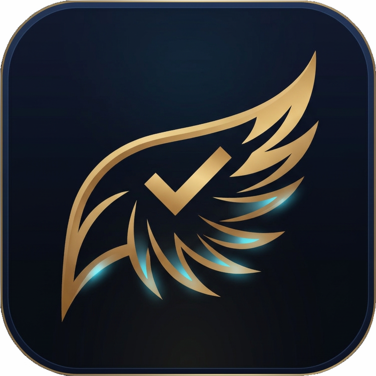
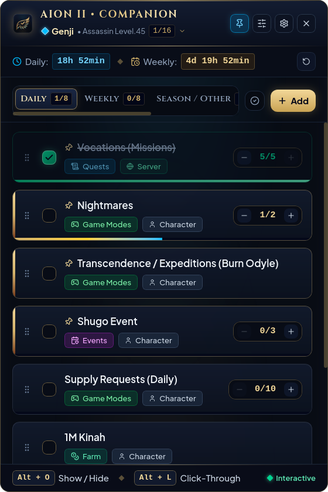
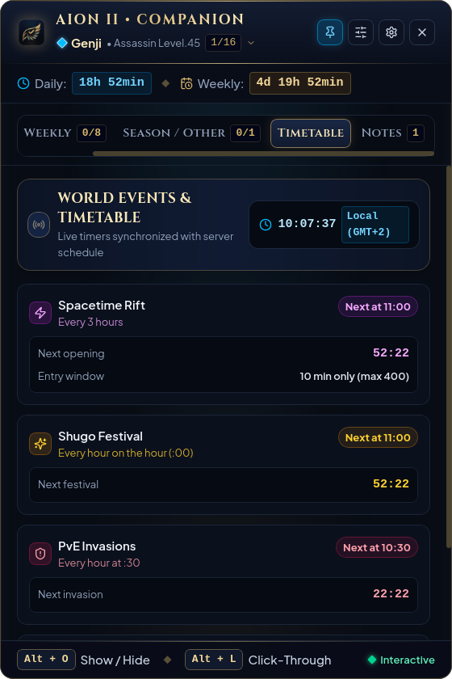
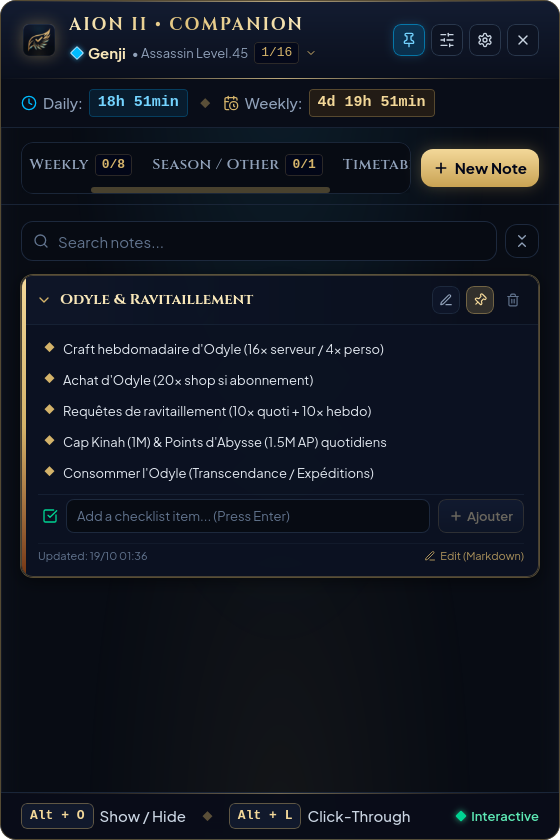
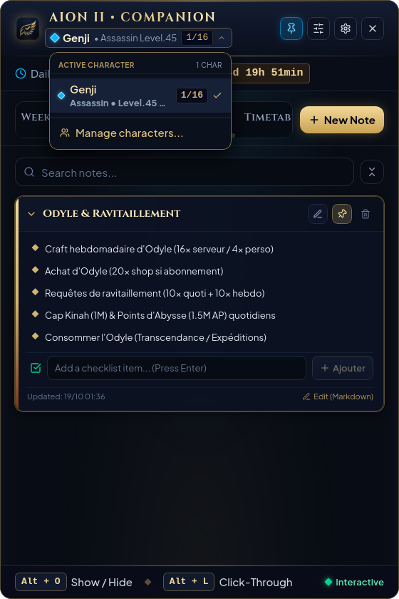
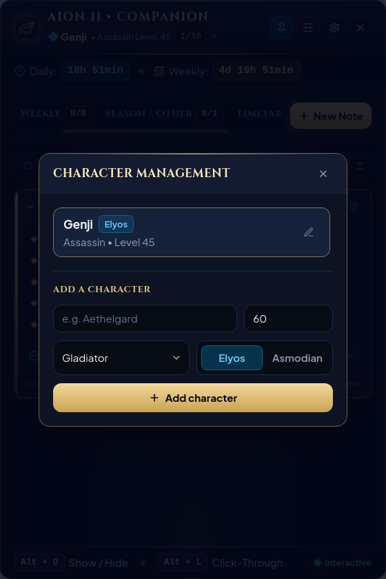
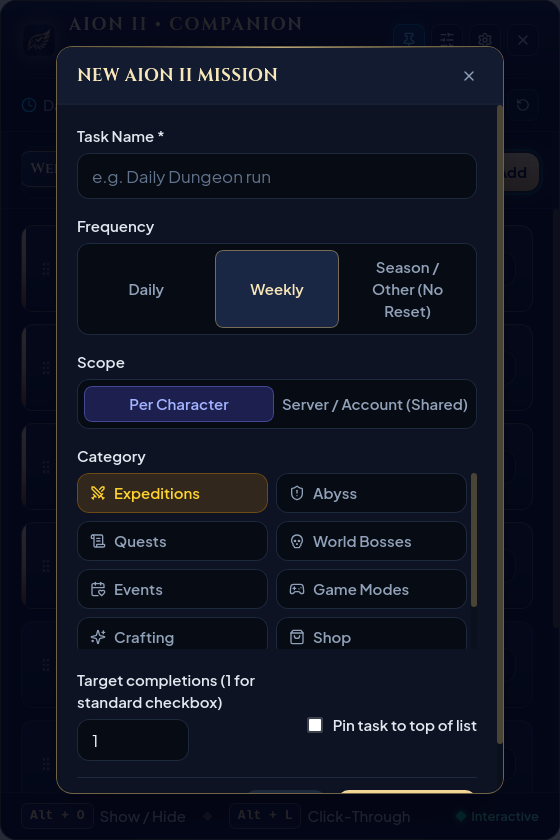
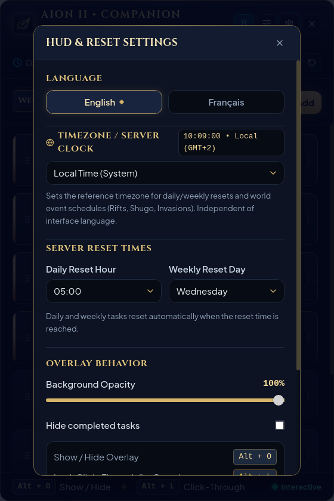

  

# Aion II • Companion

  <strong>The Ultimate In-Game Tactical HUD & Daily Routine Codex for Aion 2</strong>

  <strong>🇬🇧 English</strong> &nbsp;|&nbsp; <a href="README.fr.md">🇫🇷 Français</a>

  
  
  
  
  

---

## 🛡️ 100% Local, Private & Zero Anti-Cheat Ban Risk

> [!IMPORTANT]
> **No Login Required • 100% Local Storage • Zero DLL Injection • Zero Ban Risk**

- **No Account or Password Required**: You will **never** be asked for your Aion 2 credentials, account name, email, or password. The companion works immediately upon launch with zero registration.
- **100% Local & Private Storage**: All your characters, custom tasks, tactical notes, and settings are saved exclusively on your local machine. Zero telemetry, zero external cloud dependencies, zero tracking.
- **Zero DLL Injection & Memory Hooking**: The application strictly never injects any DLL or code into the Aion 2 game client, does not hook into RAM, and never touches or modifies game files.
- **Zero Packet Interception**: Operates without inspecting or sniffing game network traffic.
- **Safe External Overlay Architecture (Similar to Discord or OBS)**: The companion runs purely as a hardware-accelerated, transparent desktop window floating above your screen. Anti-cheat engines (Easy Anti-Cheat, GameGuard, Xigncode, NCsoft Security) recognize it as a standard, harmless desktop application, exactly like a floating notepad, Discord overlay, or OBS.
- **Full Compliance & Safety**: 100% compliant with standard gaming terms of service; cannot trigger false-positive cheat detections.

---

## Overview

**Aion II • Companion** is a luxury, lightweight, in-game transparent HUD overlay tailored specifically for **Aion 2** players. Designed to float seamlessly over your game client, it keeps your daily routines, weekly caps, world events, spacetime rifts, and tactical memos instantly accessible without ever needing to Alt-Tab.

Built with an ultra-lightweight Rust desktop core (Tauri v2) and a modern UI powered by React 19 and Tailwind CSS v4, the companion delivers unmatched fluidity, near-zero hardware footprint (< 40 MB of RAM, 0% idle CPU), and an elegant visual design inspired by the timeless dark-steel and gold aesthetics of Atréia.

---

## 📸 Application Preview

<table>
  <tr>
    <td align="center" width="50%">
      <strong>Daily & Weekly Routines</strong>  
      
    </td>
    <td align="center" width="50%">
      <strong>Live World Events & Timetable</strong>  
      
    </td>
  </tr>
  <tr>
    <td align="center" width="50%">
      <strong>Tactical Notes & Interactive Checklists</strong>  
      
    </td>
    <td align="center" width="50%">
      <strong>Quick Character Switcher</strong>  
      
    </td>
  </tr>
  <tr>
    <td align="center" width="50%">
      <strong>Character Management (Classes & Factions)</strong>  
      
    </td>
    <td align="center" width="50%">
      <strong>Custom Mission Creator</strong>  
      
    </td>
  </tr>
  <tr>
    <td align="center" colspan="2">
      <strong>HUD, Server Clock & Reset Settings</strong>  
      
    </td>
  </tr>
</table>

---

## Key Features

### 1. In-Game Transparent HUD Overlay
- **Always On Top**: Floats seamlessly above your game client in borderless or windowed mode.
- **Click-Through Mode (`Alt + L`)**: Instantly locks the HUD into click-through mode, allowing all mouse and keyboard inputs to pass straight into Aion 2 while keeping your mission trackers fully visible.
- **Collapsible Mini Pill (`Alt + O`)**: Collapse the entire overlay into an unobtrusive, floating diamond emblem with a single keystroke, or restore the full window anytime.
- **Customizable Opacity**: Adjust background transparency (40% to 100%) on the fly via the quick-access header slider or settings menu to match any in-game environment.
- **Smooth Window Dragging**: Reposition the HUD anywhere on your screens with ease.

---

### 2. Multi-Character & Account Scope Management
- **Instant Character Switching**: Seamlessly jump between characters via the header dropdown.
- **Full Class & Faction Support**: Complete tracking for all 8 Aion classes (*Gladiator, Templar, Assassin, Ranger, Sorcerer, Spiritmaster, Cleric, Chanter*) and factions (*Elyos & Asmodian*).
- **Dual-Scope Task Engine**:
  - **Per-Character Scope**: Track daily dungeons, awakening trials, and individual character progression separately for each hero.
  - **Account / Server Scope**: Track shared objectives (account-wide orders, crafting quotas, currency caps) once across all characters.
- **Completion Badges**: Live counters display completed versus total tasks for each hero.

---

### 3. Server Clock & Timezone Engine
- **Independent Timezone Calibration**: Decouple your interface language from server time. Choose from pre-configured server regions (*Europe, Asia/Korea/Taiwan, Americas, Oceania*) or select any standard IANA timezone.
- **Live Server Clock**: Always see the exact official server time directly in the HUD header and timetable.
- **Smart Automatic Resets**:
  - Customizable daily reset hour (default `09:00`).
  - Customizable weekly reset day and hour (default `Wednesday 09:00`).
  - Background tick engine detects when reset boundaries are crossed and clears your progression automatically.
  - Live real-time countdown banners for both daily and weekly resets with hours (`h`) and minutes (`min`) formatting, plus manual override buttons.

---

### 4. World Events & Live Timetable
Stay ahead of every scheduled open-world event with synchronized timers and countdowns:
- **Spacetime Rifts (Failles Spatio-Temporelles)**:
  - Exact 3-hour recurrence cycle (`02:00, 05:00, 08:00, 11:00, 14:00, 17:00, 20:00, 23:00`).
  - Highlights 10-minute entry windows (max 400 players) and in-game GPS shortcut guides.
- **Shugo Festival**:
  - Live alert every hour on the hour (`:00`).
  - Tracks the daily 3 free chest keys resetting at 09:00.
- **PvE Invasions (Failles Dimensionnelles)**:
  - Triggers every hour at the half-hour (`:30`) across starter and contested regions.
- **Abyss Artifact Sieges (Reshanta)**:
  - Scheduled alert on Mondays, Thursdays, and Saturdays at 21:00 server time.

---

### 5. Curated Aion 2 Routine Codex & Free Tasks
Comes pre-loaded with essential routines and caps for Aion 2 endgame:
- **Daily Routines**:
  - Daily Vocations Missions (`5x` account-wide).
  - Nightmares (`2x` per character).
  - Daily Supply Requests (`10x`).
  - Kinah Daily Cap (`1,000,000 Kinah`).
  - Abyss Points Daily Cap (`1,500,000 AP`).
  - Transcendence / Expeditions (Odyle burn).
  - PvE Invasions & Shugo Events.
- **Weekly Routines**:
  - Abyss Vocations Orders.
  - Odyle Crafting (`16x` server / `4x` character).
  - Odyle Shop / Subscription Purchase (`20x`).
  - Buy 20 Abyss Orders & 12 Altgard Orders.
  - Daily Dungeons (`14x` weekly per character).
  - Awakening Trials.
- **One-off / Seasonal / Objective Tasks**:
  - Dedicated tab for freeform tasks that do not depend on periodic resets (e.g. *“Buy gear piece from broker”*, master crafting milestones, equipment goals).
- **Interactive Controls**:
  - Multi-target step counters with `+` / `-` increment buttons.
  - Pin important tasks to the top of the list.
  - Drag-and-drop reordering with persistent saving.
  - Right-click context menu to edit or delete tasks.
  - Filter by frequency tabs: *Daily*, *Weekly*, *Season / Other*, *Timetable*, and *Notes*.
  - One-click toggle to show or hide completed tasks.

---

### 6. Advanced Tactical Notes & Checklist
- **Rich Formatting**: Format your memos with **bold text** (`**text**`), bullet lists, and **interactive checkboxes** (`[ ]` / `[x]`).
- **Clickable Checkboxes in Preview**: Check and uncheck sub-items directly in the note card without opening the edit modal.
- **Full Display Without Truncation**:
  - Collapsible note cards to keep the view neat and organized.
  - Uncollapsed notes display full text without premature truncation or cramped scrollbars.
- **Instant Search**: Real-time keyword filter across all titles and note contents.
- **Pinning**: Keep vital notes pinned at the top.

---

### 7. System Tray & Windows Desktop Integration
- **System Tray Icon**: High-resolution custom icon integrated into the Windows system tray and taskbar.
- **Left-Click Tray Action**: Quick-toggle between full overlay and collapsed pill HUD.
- **Right-Click Context Menu**: Instant options to toggle visibility (`Alt + O`) or exit the application cleanly.
- **Native Windows 10 & 11 Integration**: Full support for the Windows notification area, taskbar pinning, and operating system global hotkeys.

---

### 8. Native Bilingual Localization (EN / FR)
- **100% Bilingual**: Switch seamlessly between **English** and **Français** with a single click in settings.
- **Dynamic Translation**: UI controls, default missions, categories, classes, and timetable guides adapt instantly without restarting the application.

---

## Global Shortcuts & Controls

| Shortcut / Action | Function |
| :--- | :--- |
| **`Alt + O`** | **Show / Hide Full Overlay** or expand from the mini pill. |
| **`Alt + L`** | **Toggle Click-Through Mode** (allows all clicks to pass directly into Aion 2). |
| **Header Left-Click Drag** | Reposition the HUD anywhere across your monitors. |
| **Header Sliders Icon** | Open the quick opacity popover (adjust transparency from 40% to 100%). |
| **Header Pin Icon** | Toggle "Always On Top" window priority. |
| **Task Right-Click** | Open task context menu (Edit details or Delete). |
| **Grip Handle Drag** | Drag-and-drop to reorder tasks within any tab. |
| **Tray Icon Click** | Toggle overlay visibility from the system tray. |

---

## Performance & Technical Architecture

- **Rust Desktop Engine (Tauri v2)**: Native OS-level window management, global keyboard hooks, and transparent composition.
- **Zero Injections / Non-Intrusive**: Operates purely as an external transparent desktop overlay. Does not hook into the game memory, modify client files, or violate game integrity.
- **Minimal Resource Footprint**: Consumes under **40 MB of RAM** and **0% idle CPU**, ensuring zero stutter and no FPS loss during high-intensity PvP and fortress sieges.
- **Tailwind CSS v4 & Typography**: High-DPI optimized scaling with Cinzel and Trajan Pro serif accents for a true MMO aesthetic.

---

## System Requirements

- **Operating System**: Windows 10 (64-bit) or Windows 11 (64-bit) exclusively.
- **Game Display Mode**: Borderless Windowed (*Windowed Fullscreen*) or Windowed mode.
- **Hardware**: Compatible with all DirectX 11 / 12 and Vulkan systems.

---

## Legal & Disclaimer

**Aion II • Companion** is an independent third-party companion application. 

Aion, Aion 2, Atreia, Elyos, Asmodian, and all associated logos, characters, and assets are trademarks or registered trademarks of **NCSOFT Corporation**. This tool is not affiliated with, endorsed by, or sponsored by NCSOFT Corporation.

---

  <em>Copyright &copy; 2026 Aion II Companion. All rights reserved. Proprietary software.</em>

